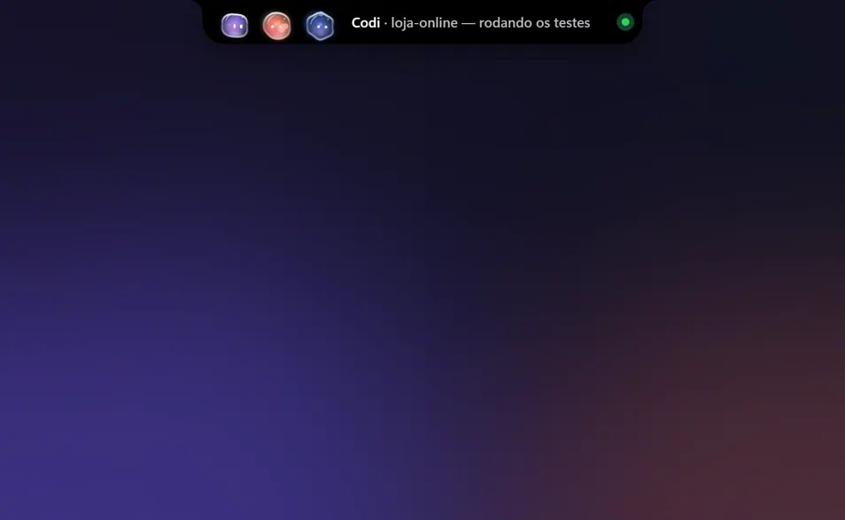
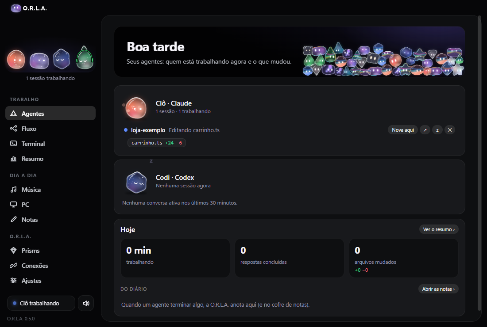
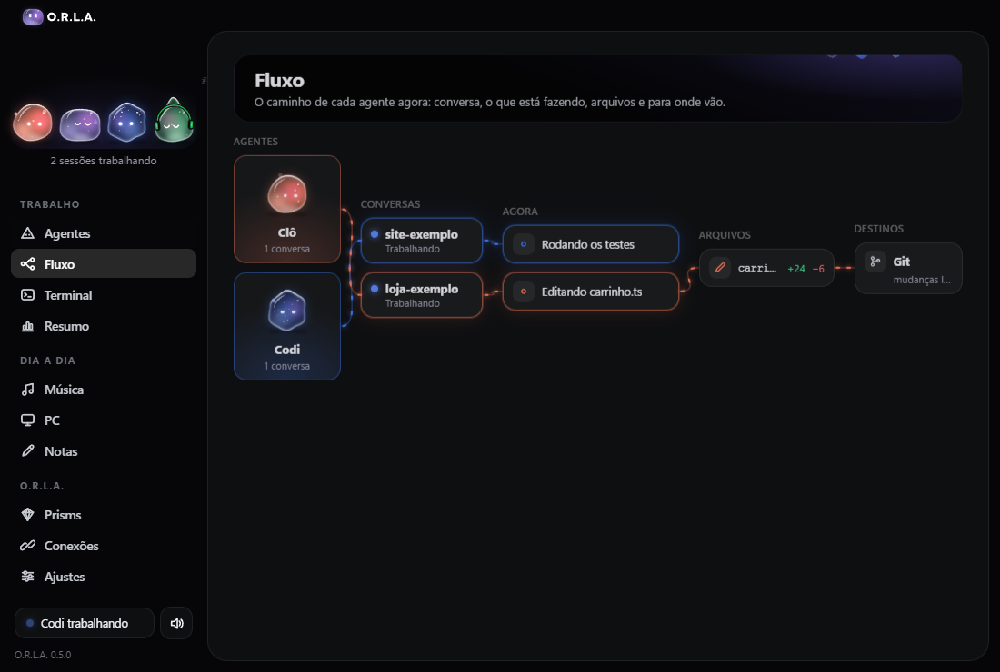
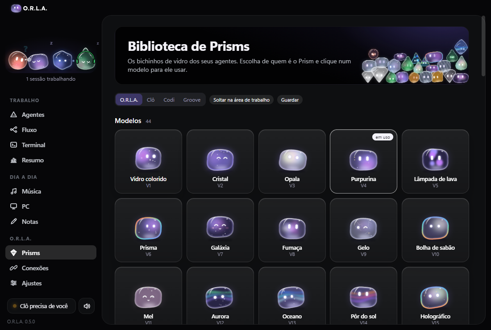
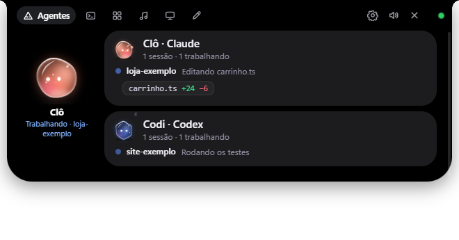
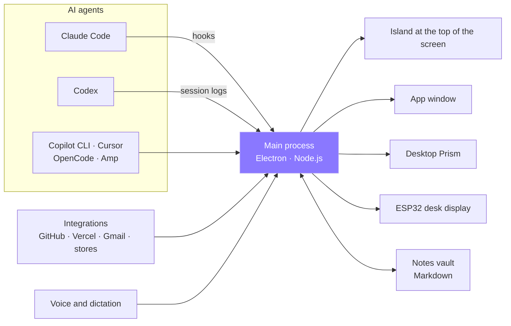

<a href="README.md">Português</a> · <b>English</b>

  

  

## About me

Software developer focused on **developer tools** for people who build software with AI agents.
I work with **Electron, Node.js and JavaScript**, and **Claude Code** and **Codex** are part of my daily workflow:
I define the architecture, split the work, review the code and own the final polish.

Right now I'm building **O.R.L.A.**, a Windows desktop app that brings your agents' status, permission requests
and notifications together on an island at the top of your screen.

Follow the development of O.R.L.A. on Instagram: **[@chr.devz](https://www.instagram.com/chr.devz/)**

---

## Featured project · O.R.L.A.

  

Recorded from the real app, in test mode with sample data. The app UI is in Portuguese.

<b>Your AI agents on an island at the top of your screen.</b> 
O.R.L.A. (<i>Orchestration &amp; Response Layer for Agents</i>) shows Claude Code, Codex and your other agents as <b>Prisms</b>, little glass creatures.
It tells you when they finish or need permission, and you answer right there, without hunting for each agent's window.

<table>
  <tr>
    <td align="center" width="25%"><h3>O</h3><b>Orchestrates</b> One request becomes a plan, split across your agents.</td>
    <td align="center" width="25%"><h3>R</h3><b>Responds</b> Permissions and questions become buttons. Plus dictation in any app.</td>
    <td align="center" width="25%"><h3>L</h3><b>Logs</b> Notes, an automatic journal and a summary of what each agent did.</td>
    <td align="center" width="25%"><h3>A</h3><b>Alerts</b> Done, failed or waiting on you: the Prism lets you know right away.</td>
  </tr>
</table>

### The crew

Every agent gets a Prism with its own shape, glass and personality. They breathe, blink, follow your mouse and react to what's going on.

  

### Inside the app

<table>
  <tr>
    <td width="50%">
<b>Agents</b> · who is working and what changed
</td>
    <td width="50%">
<b>Flow</b> · from the conversation to the files, live
</td>
  </tr>
  <tr>
    <td width="50%">
<b>Prism library</b> · 44 glass models
</td>
    <td width="50%">
<b>The island</b> · open at the top of the screen
</td>
  </tr>
</table>

Demo-mode screenshots. Everything runs on your PC, with no telemetry. The source is private and the download is coming soon.

### By the numbers

  

### How it was built

  

<b>Architecture</b>

 

- **Local-first:** agents are read from the logs and hooks they already write on your machine. Nothing leaves your PC unless you turn it on.
- **Prisms rendered in SVG** by a custom engine: glass, caustics, particles, eyes that follow the mouse and 14 outfits.
- **Nothing runs without your OK:** every permission needs your click or your key.
- **Tested:** unit tests and end-to-end tests of the running app, with reference screenshots.

---

## Stack

| Area | Technologies |
|---|---|
| Desktop | Electron · Node.js · JavaScript · HTML · CSS |
| Graphics | SVG, with a custom character and animation engine |
| Windows | PowerShell · C# (.NET) |
| Hardware | ESP32 |
| AI | Claude Code · Codex · MCP · OpenRouter · Ollama · LM Studio |
| Build | electron-builder · esbuild · Git |

---

   
  <b>On the edge of your screen.</b> 
  <a href="https://www.instagram.com/chr.devz/">Instagram @chr.devz</a>

