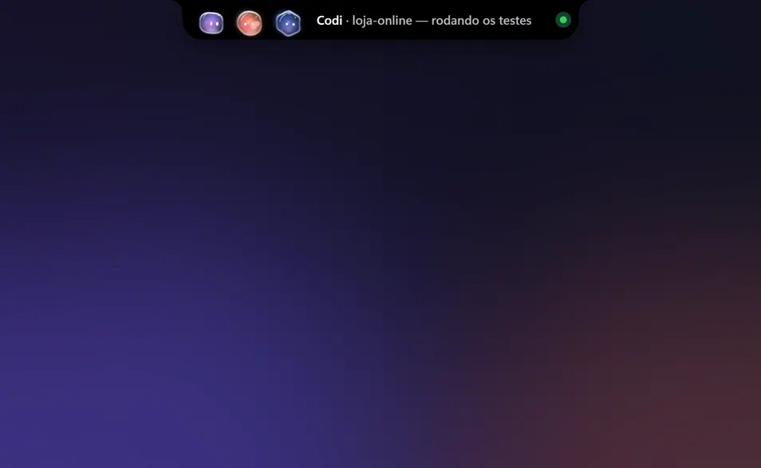
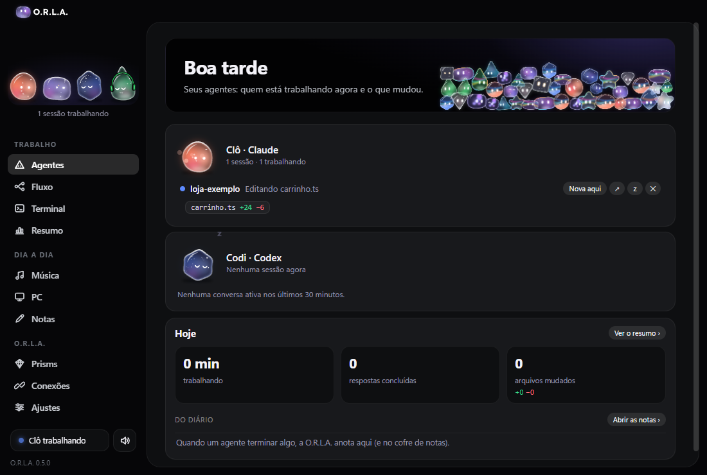
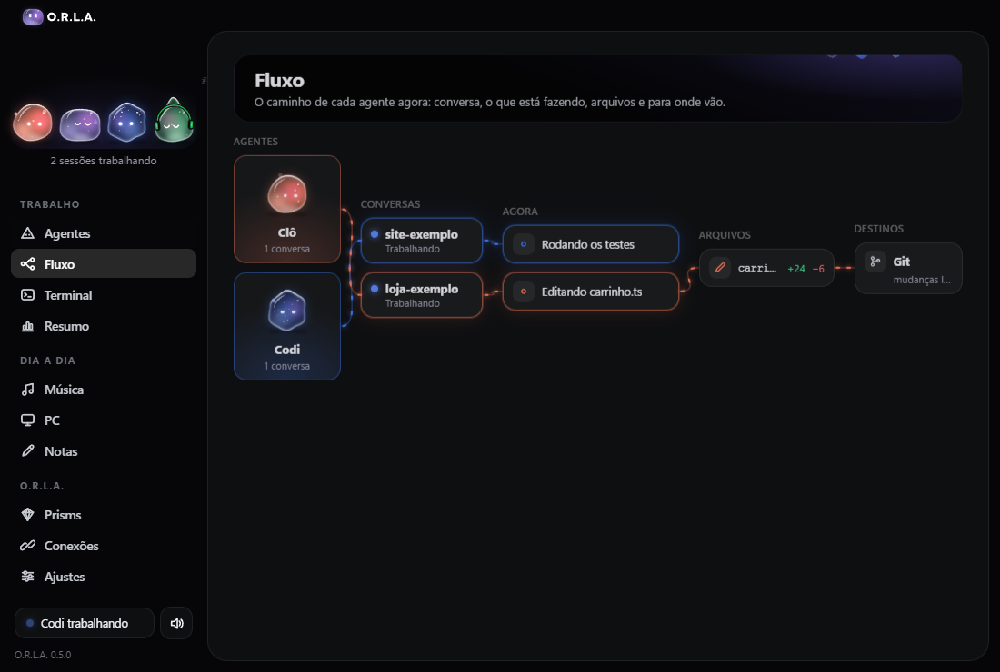
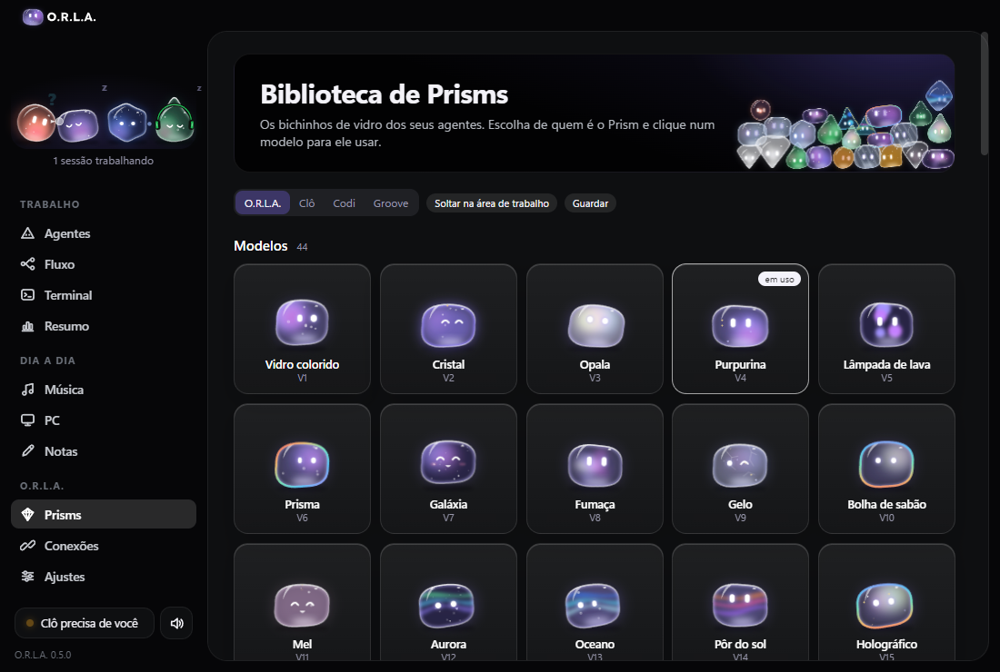
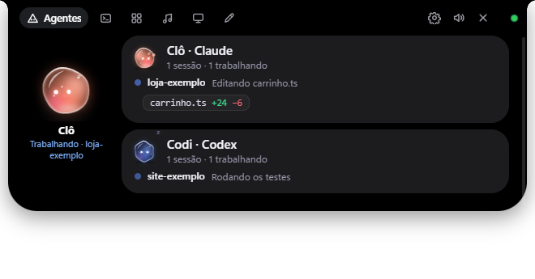
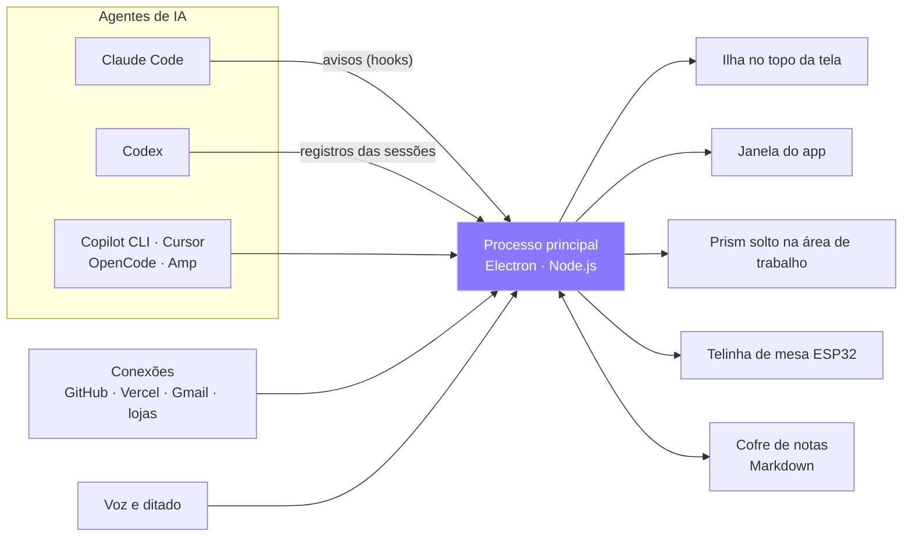

<b>Português</b> · <a href="README.en.md">English</a>

  

  

## Sobre mim

Desenvolvedor focado em **ferramentas de desenvolvimento** para quem programa com agentes de IA.
Trabalho com **Electron, Node.js e JavaScript**, e uso o **Claude Code** e o **Codex** no dia a dia:
eu defino a arquitetura, divido as tarefas, reviso o código e cuido do acabamento.

Hoje estou construindo a **O.R.L.A.**, um app desktop para Windows que reúne o status, as permissões e os avisos
dos seus agentes numa ilha no topo da tela.

Acompanhe o desenvolvimento da O.R.L.A. no Instagram: **[@chr.devz](https://www.instagram.com/chr.devz/)**

---

## Projeto em destaque · O.R.L.A.

  

Gravação da O.R.L.A. de verdade, em modo de teste com dados de exemplo.

<b>Seus agentes de IA numa ilha no topo da tela.</b> 
A O.R.L.A. mostra o Claude Code, o Codex e os seus outros agentes como <b>Prisms</b>, bichinhos de vidro.
Ela avisa quando eles terminam ou pedem permissão, e você responde dali, sem caçar a janela de cada um.

<table>
  <tr>
    <td align="center" width="25%"><h3>O</h3><b>Orquestra</b> Um pedido seu vira um plano, dividido entre os seus agentes.</td>
    <td align="center" width="25%"><h3>R</h3><b>Responde</b> Permissões e perguntas viram botões. E você dita em qualquer programa.</td>
    <td align="center" width="25%"><h3>L</h3><b>Lembra</b> Notas, diário automático e o resumo do que cada agente fez.</td>
    <td align="center" width="25%"><h3>A</h3><b>Avisa</b> Terminou, deu erro ou precisa de você: o Prism avisa na hora.</td>
  </tr>
</table>

### A turma

Cada agente ganha um Prism com formato, vidro e jeito próprios. Eles respiram, piscam, olham para o mouse e reagem ao que acontece.

  

### Por dentro do app

<table>
  <tr>
    <td width="50%">
<b>Agentes</b> · quem está trabalhando e o que mudou
</td>
    <td width="50%">
<b>Fluxo</b> · da conversa aos arquivos, ao vivo
</td>
  </tr>
  <tr>
    <td width="50%">
<b>Biblioteca de Prisms</b> · 44 modelos de vidro
</td>
    <td width="50%">
<b>A ilha</b> · aberta no topo da tela
</td>
  </tr>
</table>

Fotos do modo demonstração. Tudo roda no seu PC, sem telemetria. O código é privado e o download sai em breve.

### Em números

  

### Como foi feita

  

<b>Arquitetura</b>

 

- **Tudo local:** os agentes são lidos pelos registros e avisos que eles mesmos já gravam no PC. Nada sai do computador sem você ligar.
- **Prisms desenhados em SVG** por um motor próprio: vidro, cáusticas, partículas, olhos que seguem o mouse e 14 roupas.
- **Nada roda sem o seu OK:** toda permissão depende do seu clique ou da sua tecla.
- **Testado:** testes automáticos de unidade e do app aberto, com fotos de referência das telas.

---

## Stack

| Área | Tecnologias |
|---|---|
| Desktop | Electron · Node.js · JavaScript · HTML · CSS |
| Gráficos | SVG, com motor próprio de personagens e animação |
| Windows | PowerShell · C# (.NET) |
| Hardware | ESP32 |
| IA | Claude Code · Codex · MCP · OpenRouter · Ollama · LM Studio |
| Build | electron-builder · esbuild · Git |

---

   
  <b>Na orla da sua tela.</b> 
  <a href="https://www.instagram.com/chr.devz/">Instagram @chr.devz</a>

